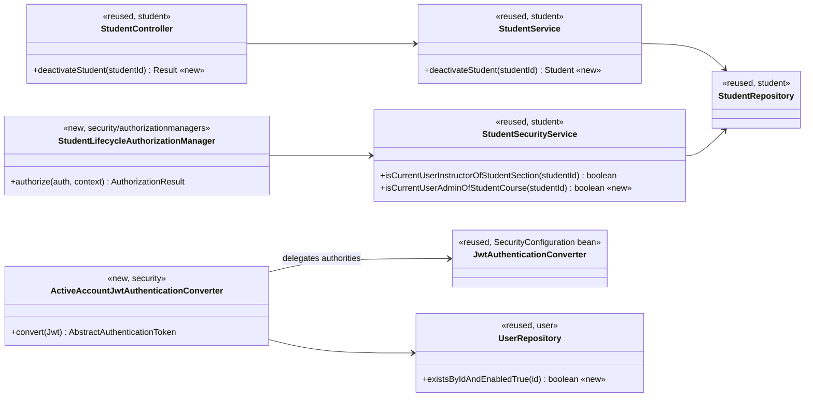
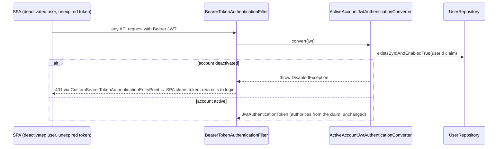

# Students (STU) Design

> Realizes: UC-STU-deactivate-student
> Depends on: FR-SEC-active-account, BR-student-lifecycle, BR-submission-owed (already excludes a deactivated student; see [not.md](not.md))
> See: [use cases](../requirements/use-cases.md#student), [SRS security requirements](../requirements/software-requirements-specification.md), [architectural-design.md](architectural-design.md#shared-foundation-components) (shared foundation component view, Crosscutting Concepts › Security & Compliance)
> Designed against `main` at `59f0267` (2026-11-03).

## Overview

This area covers the student lifecycle in the `student` foundation slice: who may change a student's account state, and how that state takes effect. Deactivation is a **state change on the existing `enabled` flag** of `PeerEvaluationUser`. It is not a removal: team membership, weekly activity reports, and peer evaluations are left alone, so the change can be reversed (UC-STU-reactivate-student). Downstream features already treat a deactivated student as absent (BR-submission-owed).

Before this design, the only way to deactivate a student was the `enabled` field of the generic `PUT /students/{studentId}` edit. That route also admits the student themselves, the actor was never warned about the consequences, and the flag was checked only at login. A deactivated student's existing JWT therefore kept working for up to its 2-hour lifetime, in breach of FR-SEC-active-account.

## Components & classes



| Component | File | Reused / new |
|---|---|---|
| `StudentController.deactivateStudent` | [StudentController.java](../../backend/src/main/java/team/projectpulse/student/StudentController.java) | new method |
| `StudentService.deactivateStudent` | [StudentService.java](../../backend/src/main/java/team/projectpulse/student/StudentService.java) | new method; reuses `ObjectNotFoundException` |
| `StudentSecurityService.isCurrentUserAdminOfStudentCourse` | [StudentSecurityService.java](../../backend/src/main/java/team/projectpulse/student/StudentSecurityService.java) | new method, the mirror of `InstructorSecurityService.isCurrentUserAdminOfInstructorCourse`: compares the caller's id with `student.getSection().getCourse().getCourseAdmin()`; fails closed |
| `StudentLifecycleAuthorizationManager` | `backend/.../security/authorizationmanagers/` | new; UC-STU-reactivate-student reuses it |
| `ActiveAccountJwtAuthenticationConverter` | `backend/.../security/` | new; wraps the existing `jwtAuthenticationConverter()` bean in [SecurityConfiguration.java](../../backend/src/main/java/team/projectpulse/security/SecurityConfiguration.java) and is wired into `oauth2ResourceServer().jwt()` |
| `UserRepository.existsByIdAndEnabledTrue` | [UserRepository.java](../../backend/src/main/java/team/projectpulse/user/UserRepository.java) | new derived query |
| Already-deactivated conflict | `system/exception` | a domain exception mapped by `ExceptionHandlerAdvice` to `StatusCode.CONFLICT`; reuse an existing conflict exception if the advice already maps one |
| `deactivateStudent(id)` | [apis/student/index.ts](../../frontend/src/apis/student/index.ts) | new |
| Deactivate control | [Students.vue](../../frontend/src/pages/students/Students.vue) | extended: a Deactivate button in the Operations column, shown only for an active student, opening an `ElMessageBox.confirm`; the Status tag reads `Active` / `Deactivated` (the use cases' vocabulary) instead of `Enabled` / `Disabled` |

## Sequence

### UC-STU-deactivate-student: deactivate a student

```mermaid
sequenceDiagram
  actor A as Course admin / instructor
  participant V as Students.vue
  participant API as apis/student
  participant M as StudentLifecycleAuthorizationManager
  participant S as StudentService
  participant R as StudentRepository
  A->>V: steps 1–3: find the student, choose Deactivate
  V->>A: step 4: confirm dialog stating the consequences (Associated Information)
  alt 5a: cancel
    A-->>V: Cancel (no request is sent)
  else step 5: confirm
    V->>API: deactivateStudent(id)
    API->>M: PATCH /students/{studentId}/deactivate
    M->>M: isCurrentUserAdminOfStudentCourse ∨ isCurrentUserInstructorOfStudentSection
    alt not permitted, or id unresolvable
      M-->>V: 403
    else permitted
      M->>S: deactivateStudent(studentId)
      S->>R: findById (404 if absent)
      alt 3a: already deactivated
        S-->>V: 409 CONFLICT
        V->>A: "This student is already deactivated"; reload list
      else
        S->>R: setEnabled(false), save
        S-->>V: 200 Result(StudentDto, enabled=false)
        V->>A: step 6: success message; reload list
      end
    end
  end
```

### FR-SEC-active-account: a live token of a deactivated account



## API contract

| Endpoint or job | Caller (who may) | Request | Success | Errors, by extension |
|---|---|---|---|---|
| `PATCH /api/v1/students/{studentId}/deactivate` | the course admin of the student's course, or an instructor assigned to the student's course section (`StudentLifecycleAuthorizationManager`); never a student | path `studentId`; no body | 200 `Result`, `data` = the `StudentDto` with `enabled = false` | 3a already deactivated → 409 `CONFLICT`; caller not permitted, or an id naming no student (the guard fails closed) → 403 |
| Every bearer-token request (filter chain) | any authenticated user | the JWT's `userId` claim | the request continues as before | account deactivated → 401 (FR-SEC-active-account) |

## Key decisions

1. **A dedicated `PATCH …/deactivate` action, not `PUT /students/{studentId}` with `enabled = false`.** The generic update route is guarded by `UserOwnershipAuthorizationManager`, which admits the student themselves. It also mixes a lifecycle change with profile edits, and it has no place for the 409 of extension 3a. A verb sub-resource under `PATCH` follows `PATCH /teams/{teamId}/section`. UC-STU-reactivate-student gets the sibling `…/reactivate`.
2. **A new `StudentLifecycleAuthorizationManager` encodes BR-student-lifecycle exactly**: course admin of the student's course ∨ instructor assigned to the student's course section, never self. Rejected: `UserOwnershipAuthorizationManager` (admits self) and `StudentInstructorAuthorizationManager` (denies a course admin who is not also assigned to that course section). No scoped query (enforcement point 2) is needed: the only object named is the path id the manager itself resolved, and no team scope applies.
3. **FR-SEC-active-account is enforced in the JWT authentication converter, on every bearer-token request**, with one primary-key `exists` query. Rejected alternatives:
   - A token blocklist: it adds revocation state and still needs a per-request read.
   - A shorter token lifetime: the gap remains, and every user re-authenticates more often.
   - A check inside each authorization manager: it would miss the routes guarded by `hasAuthority` or `.authenticated()`, such as `POST /students/search`.

   The converter throws `DisabledException`. `BearerTokenAuthenticationFilter` turns that into a 401 through the existing entry point, and the SPA's shared Axios instance already handles a 401 by clearing the token and redirecting to login. The same check covers a deactivated instructor (UC-INS-deactivate-instructor) at no extra cost.
4. **Extension 3a returns 409, not an idempotent 200**, so an actor working from a stale list is told the student was already deactivated, as the extension requires.
5. **Deactivation touches only the `enabled` flag.** Team membership, weekly activity reports, and peer evaluations stay as they are. Removing the student from their team was rejected: reactivation could not restore it, and BR-student-lifecycle requires the student's submitted work to be preserved. Excluding a deactivated student from reminders and teammate evaluation is already handled by BR-submission-owed.

## Data model

No delta. The `enabled` column of `PeerEvaluationUser` already exists; the only addition is a derived query on `UserRepository`.

## Reuse & cross-cutting

- **Reused:** the `Result` envelope and `ExceptionHandlerAdvice`; the `*SecurityService` + `AuthorizationManager` pair with fail-closed guards (architecture-of-record, Authorization); the existing JWT authorities converter; the shared Axios instance's 401/403 handling.
- **Not used:** email. This use case notifies no one but the actor. UC-STU-reactivate-student notifies the student.

## Tests

| Use case, flow | Level | Asserts |
|---|---|---|
| UC-STU-deactivate-student, main success (course admin) | integration (`StudentIntegrationTest`) | the course admin `PATCH`es → 200, `data.enabled` is false; a subsequent login as that student → 401 |
| UC-STU-deactivate-student, main success (instructor of the course section) | integration | an instructor assigned to the student's course section → 200 |
| UC-STU-deactivate-student, main success | unit (`StudentServiceTest`) | `enabled` is set to false and saved; the student's team is unchanged |
| UC-STU-deactivate-student, 3a already deactivated | unit + integration | 409 `CONFLICT`; no save |
| UC-STU-deactivate-student, 5a cancel | — | client-only, and no request is sent; no backend test |
| UC-STU-deactivate-student, caller is a student (self or another) | integration | 403; `enabled` unchanged |
| UC-STU-deactivate-student, instructor of another course section | integration | 403 |
| UC-STU-deactivate-student, unknown student id | integration | 403 (guard fails closed) |
| FR-SEC-active-account, live token | integration | a token obtained before deactivation, used on a protected route afterwards (e.g. `GET /students/{own id}`) → 401 |
| FR-SEC-active-account, active account | unit (`ActiveAccountJwtAuthenticationConverterTest`) | an active user converts with the claim's authorities unchanged; a deactivated one throws `DisabledException` |

## Open questions / risks

- **The generic `enabled` toggle stays for now.** `StudentService.updateStudent` and `EditStudentForm.vue` still write `enabled`, so until UC-STU-reactivate-student is built it remains the only way to reactivate a student. Remove both when the `…/reactivate` endpoint lands; until then there are two ways to deactivate.
- **Cost of the per-request check.** It adds one indexed primary-key query to every authenticated request. That is negligible at single-tenant scale. If it ever shows up in tracing, cache it with a short TTL rather than dropping it.
- **Out of scope, logged as OI-65:** `DELETE /students/{studentId}` is guarded by `UserOwnershipAuthorizationManager`, so a student passes the route rule for their own account, contrary to BR-student-lifecycle (course admin only).
