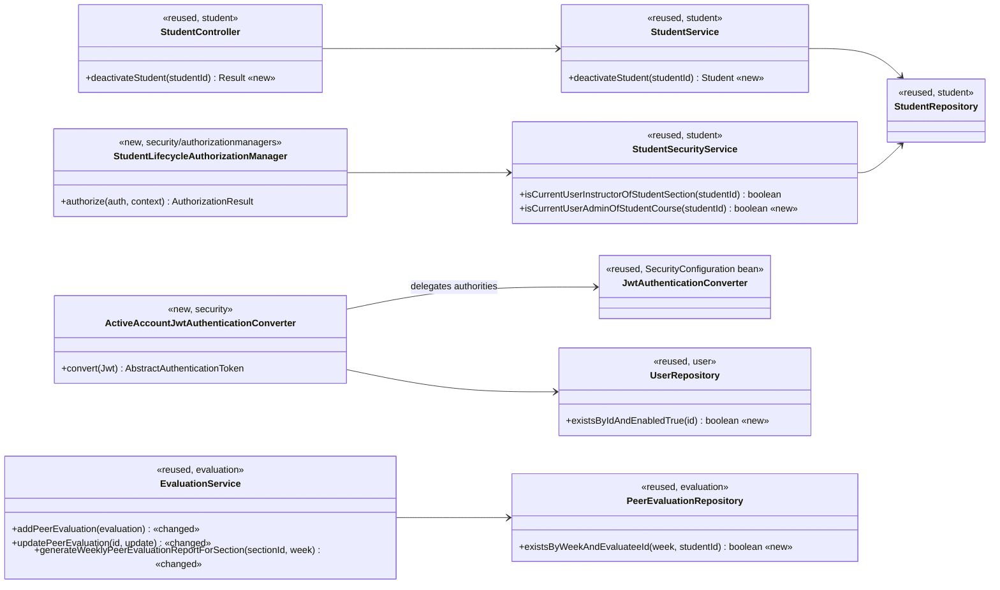
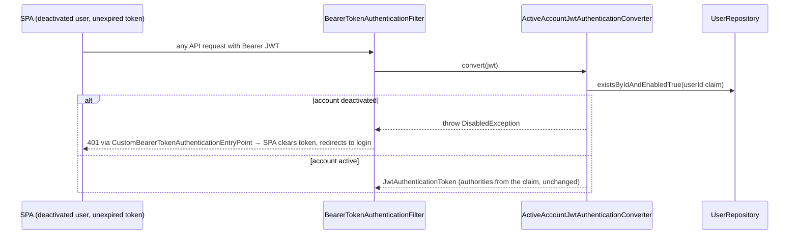

# Students (STU) Design

> Realizes: UC-STU-deactivate-student
> Depends on: FR-SEC-active-account, BR-student-lifecycle, BR-deactivated-evaluatee, BR-submission-owed (see [not.md](not.md))
> See: [use cases](../requirements/use-cases.md#student), [SRS security requirements](../requirements/software-requirements-specification.md), [architectural-design.md](architectural-design.md#shared-foundation-components) (shared foundation component view, Crosscutting Concepts › Security & Compliance)
> Designed against `main` at `59f0267` (2026-11-03).

## Overview

This area covers the student lifecycle in the `student` foundation slice: who may change a student's account state, and how that state takes effect. Deactivation is a **state change on the existing `enabled` flag** of `PeerEvaluationUser`. It is not a removal: team membership, weekly activity reports, and peer evaluations are left alone, so the change can be reversed (UC-STU-reactivate-student). What deactivation keeps, and who may still evaluate her, is policy owned by BR-student-lifecycle and BR-deactivated-evaluatee. This design only realizes it (Key decisions 5–7).

Before this design, the only way to deactivate a student was the `enabled` field of the generic `PUT /students/{studentId}` edit. That route also admits the student themselves, the actor was never warned about the consequences, and the flag was checked only at login. A deactivated student's existing JWT therefore kept working for up to its 2-hour lifetime, in breach of FR-SEC-active-account.

## Components & classes



| Component | File | Reused / new |
|---|---|---|
| `StudentController.deactivateStudent` | [StudentController.java](../../backend/src/main/java/team/projectpulse/student/StudentController.java) | new method |
| `StudentService.deactivateStudent` | [StudentService.java](../../backend/src/main/java/team/projectpulse/student/StudentService.java) | new method; reuses `ObjectNotFoundException` |
| `StudentSecurityService.isCurrentUserAdminOfStudentCourse` | [StudentSecurityService.java](../../backend/src/main/java/team/projectpulse/student/StudentSecurityService.java) | new method, the mirror of `InstructorSecurityService.isCurrentUserAdminOfInstructorCourse`: compares the caller's id with `student.getSection().getCourse().getCourseAdmin()`; fails closed |
| `StudentLifecycleAuthorizationManager` | `backend/.../security/authorizationmanagers/` | new; UC-STU-reactivate-student reuses it |
| `ActiveAccountJwtAuthenticationConverter` | `backend/.../security/` | new; wraps the existing `jwtAuthenticationConverter()` bean in [SecurityConfiguration.java](../../backend/src/main/java/team/projectpulse/security/SecurityConfiguration.java) and is wired into `oauth2ResourceServer().jwt()` |
| `UserRepository.existsByIdAndEnabledTrue` | [UserRepository.java](../../backend/src/main/java/team/projectpulse/user/UserRepository.java) | new derived query |
| `StudentAlreadyDeactivatedException` | `system/exception` | new; mapped in [ExceptionHandlerAdvice.java](../../backend/src/main/java/team/projectpulse/system/exception/ExceptionHandlerAdvice.java) exactly like `SectionLockRequiredException`: HTTP 409 **and** `Result.code` `StatusCode.CONFLICT`, message "This student is already deactivated." |
| Route rule | [SecurityConfiguration.java](../../backend/src/main/java/team/projectpulse/security/SecurityConfiguration.java) | new `requestMatchers(HttpMethod.PATCH, baseUrl + "/students/{studentId}/deactivate").access(studentLifecycleAuthorizationManager)` in the `/students/**` block, above the `denyAll()` catch-all. No existing rule shadows it: the others match `/students/{studentId}` exactly |
| `deactivateStudent(studentId)` | [apis/student/index.ts](../../frontend/src/apis/student/index.ts) | new; `PATCH /students/{studentId}/deactivate` through the shared instance, typed like the module's existing calls |
| Deactivate control | [Students.vue](../../frontend/src/pages/students/Students.vue) | extended: a Deactivate button in the Operations column, shown only for an active student, opening an `ElMessageBox.confirm` (`type: 'warning'`) whose body states the consequences in the use case's Associated Information. On success, `ElMessage.success` and reload the current page. On a rejected call, add no second message (the shared instance has already shown the error toast) and reload. Only the Status tag changes from `Enabled` / `Disabled` to `Active` / `Deactivated` (the use cases' vocabulary) |
| Deactivated-evaluatee guard | [EvaluationService.java](../../backend/src/main/java/team/projectpulse/evaluation/EvaluationService.java) `addPeerEvaluation`, `updatePeerEvaluation` | extended: next to the existing same-team check, enforce BR-deactivated-evaluatee with `PeerEvaluationIllegalArgumentException` (400) |
| Section report rows | `EvaluationService.generateWeeklyPeerEvaluationReportForSection`, new `PeerEvaluationRepository.existsByWeekAndEvaluateeId` | extended: applies BR-deactivated-evaluatee's listing clause (decision 7) |
| Active-teammate list | [SubmitTeamsEvaluations.vue](../../frontend/src/pages/evaluations/SubmitTeamsEvaluations.vue) | extended: filters the `findStudentsByTeamId` result to `enabled` teammates, per the amended UC-EVA-submit-evaluation step 2, and in edit mode filters the evaluator's saved evaluations to those same teammates (decision 6). This is a convenience only; the server guard above is the enforcement |

## Sequence

### UC-STU-deactivate-student: deactivate a student

```mermaid
sequenceDiagram
  actor A as Course admin / instructor
  participant V as Students.vue
  participant API as apis/student
  participant M as StudentLifecycleAuthorizationManager
  participant S as StudentService
  participant R as StudentRepository
  A->>V: steps 1–3: find the student, choose Deactivate
  V->>A: step 4: confirm dialog stating the consequences (Associated Information)
  alt 5a: cancel
    A-->>V: Cancel (no request is sent)
  else step 5: confirm
    V->>API: deactivateStudent(id)
    API->>M: PATCH /students/{studentId}/deactivate
    M->>M: isCurrentUserAdminOfStudentCourse ∨ isCurrentUserInstructorOfStudentSection
    alt not permitted, or id unresolvable
      M-->>V: 403
    else permitted
      M->>S: deactivateStudent(studentId)
      S->>R: findById (404 if absent)
      alt 3a: already deactivated
        S-->>V: 409 CONFLICT
        V->>A: "This student is already deactivated"; reload list
      else
        S->>R: setEnabled(false), save
        S-->>V: 200 Result(StudentDto, enabled=false)
        V->>A: step 6: success message; reload list
      end
    end
  end
```

### FR-SEC-active-account: a live token of a deactivated account



## API contract

| Endpoint or job | Caller (who may) | Request | Success | Errors, by extension |
|---|---|---|---|---|
| `PATCH /api/v1/students/{studentId}/deactivate` | the course admin of the student's course, or an instructor assigned to the student's course section (`StudentLifecycleAuthorizationManager`); never a student | path `studentId`; no body | 200 `Result`, `data` = the `StudentDto` with `enabled = false` | 3a already deactivated → 409 `CONFLICT`; caller not permitted, or an id naming no student (the guard fails closed) → 403 |
| `POST /api/v1/evaluations`, `PUT /api/v1/evaluations/{evaluationId}` (changed) | unchanged | unchanged | unchanged | evaluatee's account is deactivated → 400, message "You cannot evaluate a deactivated teammate." (BR-deactivated-evaluatee) |
| `GET /api/v1/evaluations/sections/{sectionId}/week/{week}` (changed) | unchanged | unchanged | rows as BR-deactivated-evaluatee lists them | — |
| Every bearer-token request (filter chain) | any authenticated user | the JWT's `userId` claim | the request continues as before | account deactivated → 401 (FR-SEC-active-account) |

## Key decisions

1. **A dedicated `PATCH …/deactivate` action, not `PUT /students/{studentId}` with `enabled = false`.** The generic update route is guarded by `UserOwnershipAuthorizationManager`, which admits the student themselves. It also mixes a lifecycle change with profile edits, and it has no place for the 409 of extension 3a. A verb sub-resource under `PATCH` follows `PATCH /teams/{teamId}/section`. UC-STU-reactivate-student gets the sibling `…/reactivate`.
2. **A new `StudentLifecycleAuthorizationManager` is BR-student-lifecycle's route rule**: `isCurrentUserAdminOfStudentCourse ∨ isCurrentUserInstructorOfStudentSection`, with no self clause and nothing granted by role. Any caller the rule does not name gets 403 and nothing changes. An unauthenticated caller, or one whose own account is deactivated, gets 401 before the rule is consulted. The SPA routes a 403 to the forbidden page. An instructor not assigned to her course section never sees her in the Students list anyway: the list is scoped to the caller's default course section, and switching to a course section requires being assigned to it. Rejected: `UserOwnershipAuthorizationManager` (admits self) and `StudentInstructorAuthorizationManager` (denies a course admin who is not also assigned to that course section). No scoped query (enforcement point 2) is needed: the only object named is the path id the manager itself resolved, and no team scope applies.
3. **FR-SEC-active-account is enforced in the JWT authentication converter, on every bearer-token request**, with one primary-key `exists` query. Rejected alternatives:
   - A token blocklist: it adds revocation state and still needs a per-request read.
   - A shorter token lifetime: the gap remains, and every user re-authenticates more often.
   - A check inside each authorization manager: it would miss the routes guarded by `hasAuthority` or `.authenticated()`, such as `POST /students/search`.

   The converter is built inside `SecurityConfiguration` (with `UserRepository` injected) and passed to `.jwt(jwt -> jwt.jwtAuthenticationConverter(…))`. It reads the `userId` claim as any number: `JwtProvider` writes an `Integer`, but a decoded token returns a JSON number as a `Long`. A token with no numeric `userId` claim is treated as inactive. Authorities are whatever the wrapped converter produces, unchanged (under Spring Security 7 that includes its own `FACTOR_BEARER` authority). On an inactive account it throws `DisabledException`. `BearerTokenAuthenticationFilter` turns that into a 401 through the existing entry point, and the SPA's shared Axios instance already handles a 401 by clearing the token and redirecting to login. The same check covers a deactivated instructor (UC-INS-deactivate-instructor) at no extra cost.
4. **Extension 3a returns 409, not an idempotent 200**, so an actor working from a stale list is told the student was already deactivated, as the extension requires.
5. **Deactivation writes only the `enabled` flag.** It leaves `Student.team` and every activity and peer evaluation untouched, which is how BR-student-lifecycle's preserved work and team membership are realized. The cost of keeping her on the team is that every team-roster consumer must tell active members from deactivated ones. The three current consumers are the owed computation (`SubmissionStatusService`, already filtering), evaluation submission (decision 6), and the section peer-evaluation report (decision 7).
6. **BR-deactivated-evaluatee is enforced on the server.** `addPeerEvaluation` and `updatePeerEvaluation` reject a deactivated evaluatee next to the existing same-team check, and the form filters the roster it already fetches. Because the rule covers the open week, the check reads the account's current state; no deactivation date is needed or stored. Rejected:
   - Filtering only in the form: a client-side check is not access control.
   - Making `GET /students/teams/{teamId}` return active students only: it is a general team-roster read, and an instructor's view of the team should still show the deactivated member.

   Checked against the code (`main` at `59f0267`):
   - **Owed** (`SubmissionStatusService.findOwedItems`) already builds each team's required evaluatees from active students only, so it matches as is.
   - **Submit and edit** (`EvaluationService.addPeerEvaluation` / `updatePeerEvaluation`) do not match today. `add` checks only the window and the team. `update` checks only the window, with no evaluatee check at all, so the guard goes into both.
   - **The form** (`SubmitTeamsEvaluations.vue`) sends one request per teammate through `Promise.all`. On a form loaded before she was deactivated, her request is refused while the others save, and the submit as a whole appears to fail. On a rejected submit the form therefore reloads the teammate list and the evaluator's saved evaluations, so the evaluator sees what was kept and that she is gone.
   - **Edit mode** loads the evaluator's saved evaluations, not the roster. A saved evaluation of a since-deactivated teammate would be shown and refused on every update, reload included, so the form drops saved evaluations whose evaluatee is not an active teammate.
7. **The section peer-evaluation report applies BR-deactivated-evaluatee's listing clause in the service.** `generateWeeklyPeerEvaluationReportForSection` keeps every student whose team is set, and `getPeerEvaluationAverage` already loads `findByWeekAndEvaluateeId(week, studentId)`. So the change is to skip a deactivated student when she has no evaluation that week. As built, that is a separate `existsByWeekAndEvaluateeId` read, run only for a deactivated student, so `getPeerEvaluationAverage` (shared with the per-student summaries) is left unchanged. Rejected: filtering in the SPA, which would leave the API returning rows the rule says the report does not list. An active student no one evaluated keeps her 0.0 row, as today; the rule says nothing about her.

## Data model

No delta. The `enabled` column of `PeerEvaluationUser` already exists; the only additions are two derived queries, `UserRepository.existsByIdAndEnabledTrue` and `PeerEvaluationRepository.existsByWeekAndEvaluateeId`.

## Reuse & cross-cutting

- **Reused:** the `Result` envelope and `ExceptionHandlerAdvice`; the `*SecurityService` + `AuthorizationManager` pair with fail-closed guards (architecture-of-record, Authorization); the existing JWT authorities converter; the shared Axios instance's 401/403 handling.
- **Not used:** email. This use case notifies no one but the actor. UC-STU-reactivate-student notifies the student.

## Tests

| Use case, flow | Level | Asserts |
|---|---|---|
| UC-STU-deactivate-student, main success (course admin) | integration (`StudentIntegrationTest`) | the course admin `PATCH`es → 200, `data.enabled` is false; a subsequent login as that student → 401 |
| UC-STU-deactivate-student, main success (instructor of the course section) | integration | an instructor assigned to the student's course section → 200 |
| UC-STU-deactivate-student, main success | unit (`StudentServiceTest`) | `enabled` is set to false and saved; the student's team is unchanged |
| UC-STU-deactivate-student, 3a already deactivated | unit + integration | 409 `CONFLICT`; no save |
| UC-STU-deactivate-student, 5a cancel | — | client-only, and no request is sent; no backend test |
| UC-STU-deactivate-student, caller is a student (self or another) | integration | 403; `enabled` unchanged |
| UC-STU-deactivate-student, instructor of another course section | integration | 403 |
| UC-STU-deactivate-student, unknown student id | integration | 403 (guard fails closed) |
| UC-STU-deactivate-student, course admin not assigned to the student's course section | integration | 200. The seed's course admin is assigned to section 1, so this needs a student in a course section of her course she is not assigned to; the main-success test alone would hide a manager that checked assignment only |
| UC-STU-deactivate-student, course admin of another course | integration | 403; `enabled` unchanged |
| UC-STU-deactivate-student, unauthenticated | integration | 401 |
| UC-STU-deactivate-student, deactivated caller with a live token | integration | 401 (FR-SEC-active-account), before the route rule is consulted |
| FR-SEC-active-account, live token | integration | a token obtained before deactivation, used on a protected route afterwards (e.g. `GET /students/{own id}`) → 401 |
| FR-SEC-active-account, active account | unit (`ActiveAccountJwtAuthenticationConverterTest`) | an active user converts with the claim's authorities unchanged; a deactivated one, or a token with no `userId` claim, throws `DisabledException` |
| UC-STU-deactivate-student, team membership kept | integration | after deactivation, `GET /students/teams/{teamId}` still lists the student, with `enabled` false |
| BR-deactivated-evaluatee, evaluating a deactivated teammate | unit (`EvaluationServiceTest`) + integration | `POST /evaluations` and `PUT /evaluations/{evaluationId}` naming a deactivated evaluatee → 400; nothing saved |
| BR-deactivated-evaluatee, evaluation written before deactivation | unit | it is still returned and still counts in the evaluatee's average |
| BR-deactivated-evaluatee, section peer-evaluation report | unit (`EvaluationServiceTest`) | a deactivated student has a row for a week with evaluations of her and no row for a week without; an active student with no evaluations still has a 0.0 row |
| UC-EVA-submit-evaluation step 2 (amended), form | manual / Cypress (no frontend unit tests exist) | after a teammate is deactivated, the peer evaluation form lists only the active teammates, self included; a form opened before her deactivation and then submitted saves the others, refuses hers, and reloads without her |
| BR-submission-owed after deactivation | unit (`SubmissionStatusServiceTest`, existing case) | a teammate who evaluated every active member but not the deactivated one owes nothing. This case already exists; keep it green |

Fixtures: the integration tests use the `DataInitializer` seed (course admin `b.wei@abc.edu`, an instructor assigned to the student's course section, an instructor of another course section, students). Each test that deactivates a seed student must leave the seed as it found it, following the existing isolation pattern of `StudentIntegrationTest`. Extension 3a deactivates first, then repeats the request. Tokens come from the existing login helper of the integration tests.

## Open questions / risks

- **Where the Deactivate control lives.** UC-STU-deactivate-student step 2 has the actor view the student's details (UC-STU-view-student) before choosing to deactivate. The control is in the Students list instead, where a row click opens the performance dashboard and the Edit dialog shows the details. If the use case means a details view strictly, the step or the control's placement should change.
- **The generic `enabled` toggle stays for now.** `StudentService.updateStudent` and `EditStudentForm.vue` still write `enabled`, so until UC-STU-reactivate-student is built it remains the only way to reactivate a student. Remove both when the `…/reactivate` endpoint lands; until then there are two ways to deactivate.
- **A course admin may not be able to reach the Deactivate control (OI-66).** The server allows the course admin of her course, but the Students list shows only the caller's default course section. `PUT /instructors/sections/{sectionId}/default` is guarded by `SectionSecurityService.canAccessSection`, which admits only instructors assigned to that course section. `SectionService.saveSection` does not assign the course admin to the course sections she creates. So a course admin not assigned to the student's course section can deactivate her through the API but cannot find her in the UI. The workaround is to assign herself to the course section first. The fix belongs to the course-section access rule, which other routes share, not to this use case.
- **Future team-roster consumers.** Keeping a deactivated student on her team (decision 5) makes "active member" a condition every new team-roster consumer must apply. Three consumers are handled today. A new team-level report or count that iterates `Team.getStudents()` unfiltered will count a withdrawn student.
- **Cost of the per-request check.** It adds one indexed primary-key query to every authenticated request. That is negligible at single-tenant scale. If it ever shows up in tracing, cache it with a short TTL rather than dropping it.
- **Out of scope, logged as OI-65:** `DELETE /students/{studentId}` is guarded by `UserOwnershipAuthorizationManager`, so a student passes the route rule for their own account, contrary to BR-student-lifecycle (course admin only).
